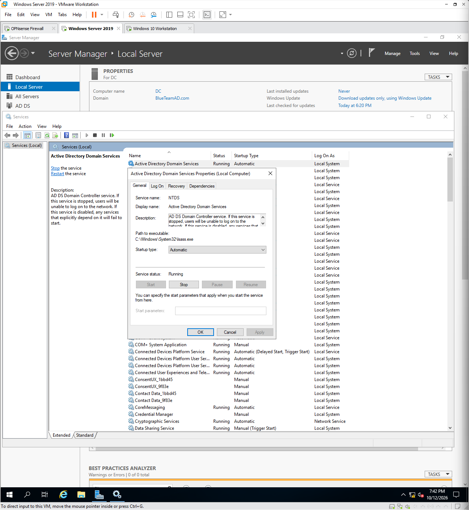
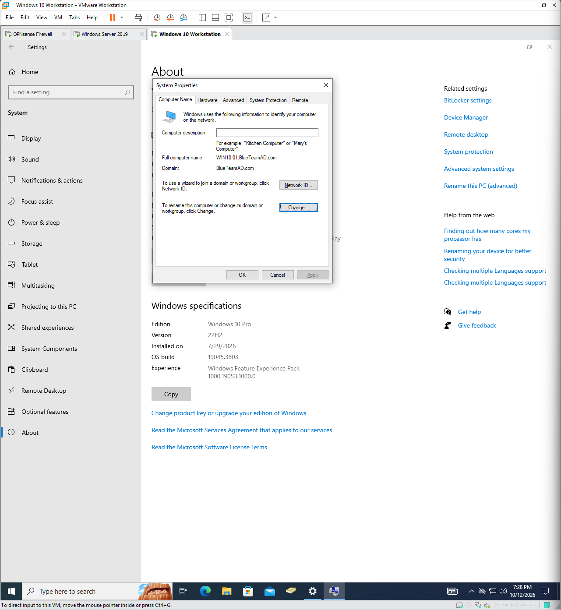

# Windows-AD-lab

Windows Server Active Directory lab simulating a small company's help desk and sysadmin environment: OU design, security groups, delegated administration, Group Policy, DHCP/DNS, and a documented troubleshooting log.

**Status:** Week 1 in progress. Weeks 2 to 4 planned.

---

## Overview

*Lab network: domain controller, workstation, and network layout.*

### Network notes
- **Subnet:** VMnet2 (`192.168.50.0/24`) is a VMware virtual switch. All lab devices plug into it as peers.
- **Gateway:** OPNsense (`192.168.50.2`) is the default gateway for the DC and WIN10-01.
- **Internet path:** OPNsense's WAN interface connects to VMnet8 (NAT), which reaches the internet through the host machine and then the home router. Traffic is translated three times: OPNsense, VMware NAT, home router.
- **DHCP:** OPNsense serves DHCP on the LAN. VMware's own DHCP service is off on VMnet2.
- **Scope:** only the LAN segment is shown. OPNsense has additional interfaces that aren't part of this lab.

### Environment

| VM | OS | Role | IP | Gateway | DNS |
|---|---|---|---|---|---|
| `DC` | Windows Server 2019 | Domain controller (AD DS, DNS) | `192.168.50.14` | `192.168.50.2` | `127.0.0.1` |
| `WIN10-01` | Windows 10 | Domain-joined workstation | `192.168.50.13` | `192.168.50.2` | `192.168.50.14` |
| `OPNsense` | OPNsense 26.7.5 | Firewall | `192.168.50.2` | `192.168.116.2` | `8.8.8.8` |

- **Domain:** `BlueTeamAD.com`
- **Hypervisor:** `VMware`

### Skills Demonstrated

- Active Directory design: OUs, security groups, user lifecycle
- Delegated administration and least privilege
- Group Policy (security and user-experience settings)
- DHCP and DNS administration
- Systematic troubleshooting, documented as symptom, diagnosis, fix

---

## Foundation: Building the Environment

> **Goal:** Stand up a working domain with a domain-joined client.

### Deploying Windows Server 2019 (DC) and Installing Active Directory

I first started by deploying a Windows Server 2019 on VMware Workstation Pro, when installing I followed VMwares installation guide and used these specs for my VM:

CPU: 2 processors and 2 cores per processor
Network Adapter: VMnet2
RAM:4GB 
Stograge:20GB

I went with the specs listed above because this Windows Server will be the Domain Controller but will not be performing many resource intensive tasks.

Moving foward I proceeded with the installation guide of Windows Server 2019 and created an Administrator account. Once the account was created I logged in to the Administrator account on the Windows Server and verify the IP address assigned was done by Kea DHCPv4 (DHCP service on my OPNsense Firewall).

Once I verified the IP address belongs to the proper subnet and within the assigned IP pool range, I created a reservation for the DC IP address so it never changes.

Then using the application Server Manager, I began to add a server role and installed Active Directory Domain Services.

I then proceed to promote the server to domain controller.

*This screenshot shows the installation of Active Directory Domain Services running on my Windows Server as well as the local server name and domain.*

### Creating the Domain
<!-- Steps: new forest, domain name, DSRM password handling (do not publish passwords) -->
Once initial setup was finished I created a new forest.

I created a new forrest and gave it the root domain name: `BlueTeamAD.com`

After deciding on a name, I gave it a DSRM password (Directory Services Restore Mode).

### Deploying Windows Workstation One (WIN10-01) and Joining the Domain
<!-- Steps: client VM, DNS pointed at the DC, domain join, first domain login -->
Deploying a Windows 10 Workstation is straightfoward, I proceed to deploy the new virtual machine and use these specs:

CPU: 2 Processors and 2 core per processor
Network Adapter: VMnet2
RAM: 4GB
Storage: 20GB

The Windows Workstation will not be doing any resource intensive tasks at the moment so there is no need to assign any more resources than what is required.

After assigning resources to the virtual machine I began installing the operating system and creating a local account.

Once I finished setting up a local account I signed in on the Windows 10 Workstation and verfied the IP address was correct and assigned by Kea DHCP.

I proceeded to open up `Settings` > `System` > `About` > `Rename This PC (advanced)`

I then clicked on the option `change` for `To rename this computer or change its domain or workgroup, click Change.`

I renamed the computer `WIN10-01` and joined it to the domain `BlueTeamAD.com`

**Note:** It is important that the Windows Server and Workstation are on the same LAN so there is no issue joining the domain.

---

## Week 1: Identity and Access Management

> **Goal:** Build a clean AD structure and give help desk staff only the permissions they need.

### Creating the OU Structure
Created `TestCompany` with sub-OUs: Users, Workstations, Servers, IT, Groups.

*TestCompany OU tree in Active Directory Users and Computers.*

**Design decision:** **Design decision:** I organized `TestCompany` by object type (Users, Workstations,
Servers, IT, Groups) rather than by department. This keeps the structure flat and
the GPO targeting simple: computer settings link to Workstations and user settings
link to Users. It also gives help desk a clear delegation boundary, since password
reset and unlock rights are granted on the Users OU alone.

**Trade-offs:** Every user in the Users OU receives the same policies. The delegated rights also apply to every account in that OU, so a
privileged account placed there could be reset by help desk.

### Creating Security Groups and Users
- Groups: `GRP-Sales`, `GRP-HR`, `GRP-IT-Admins`, `GRP-Helpdesk` (Global scope, Security type)
- Test users added to groups by department; help desk users placed in `GRP-Helpdesk`

*Members tab of GRP-Helpdesk.*

### Delegating Help Desk Permissions
Delegated **reset password** and **read/write lockoutTime** on user objects in the Users OU to `GRP-Helpdesk`.

*Final screen of the Delegate Control wizard.*

### Testing Delegation (Least Privilege)

| Test | Account | Expected | Result |
|---|---|---|---|
| Reset password in Users OU | Help desk user | Succeeds | `<Passed>` |
| Reset password in IT OU | Help desk user | Denied | `<Passed>` |
| Delete a user | Help desk user | Denied | `<Passed>` |
| Create a user | Help desk user | Not allowed | `<Passed` |
| Reset password, delete, create user | Sales user (control) | Denied or unavailable | `<Passed>` |
| Unlock a locked account | Help desk user | Succeeds | `<Pending: needs lockout policy>` |

*Help desk user resetting a password successfully. `whoami` shown.*

*Access denied on delete: `You do not have sufficient privileges to delete Ken Kaneki, or this object is protected from accidental deletion`*

### Group Policy: Security Settings
<!-- In progress. Planned: domain password and lockout policy, login banner, USB storage block -->
**Status:** In progress

### DHCP and DNS
<!-- In progress. Planned: Windows DHCP scope and reservations, DNS records, reverse lookup zone -->
**Status:** In progress

### Troubleshooting Log

| # | Symptom | Diagnosis | Fix |
|---|---|---|---|
| 1 | "Insufficient privileges" deleting a sub-OU as Domain Admin | Protect object from accidental deletion was enabled | View > Advanced Features, uncheck the setting on the Object tab, then delete |

---

## Week 2: File/Print Services and PowerShell Automation

**Status:** Planned

- File server with department shares and NTFS/share permissions
- Print server deployed through GPO
- PowerShell scripts: bulk user creation, stale account report, health checks
- Onboarding and offboarding workflow

---

## Week 3: Ticketing and Help Desk Workflow

**Status:** Planned

- Ticketing system (osTicket or GLPI) with categories, priorities, and SLA
- 10 or more realistic tickets, each documented: symptom, steps, root cause, resolution
- Knowledge base articles and asset inventory

---

## Week 4: Hybrid Identity, Patching, and Linux Automation

**Status:** Planned

- Microsoft 365 developer tenant, Entra ID sync, MFA
- WSUS or Windows Update policy
- Ansible automation and backup with a tested restore

---
